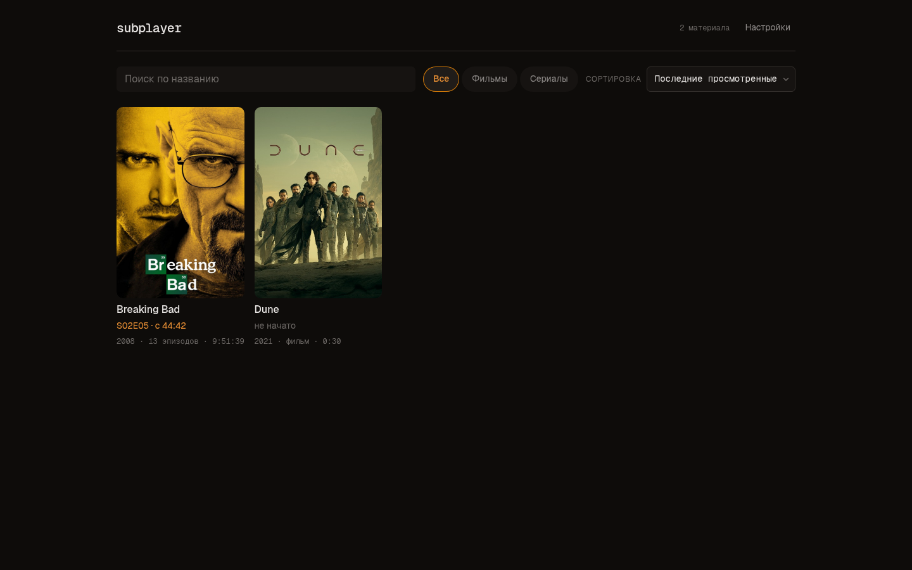
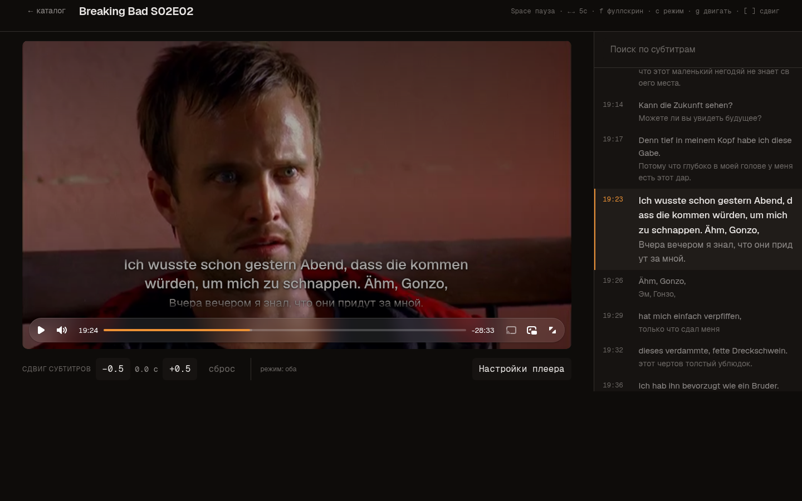
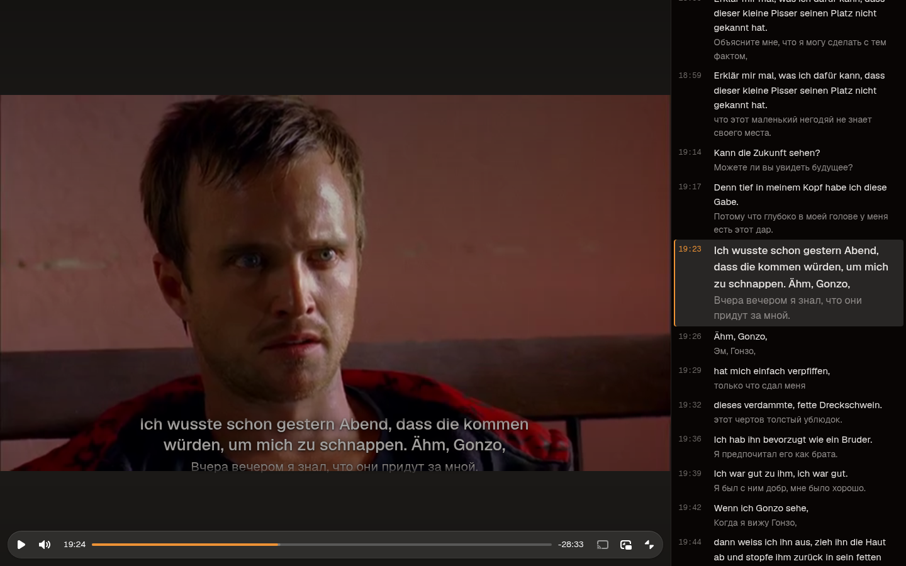
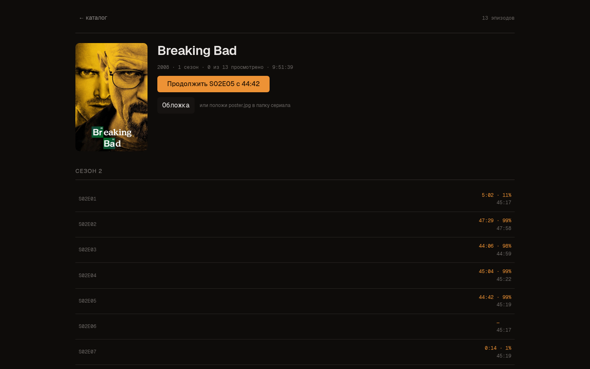
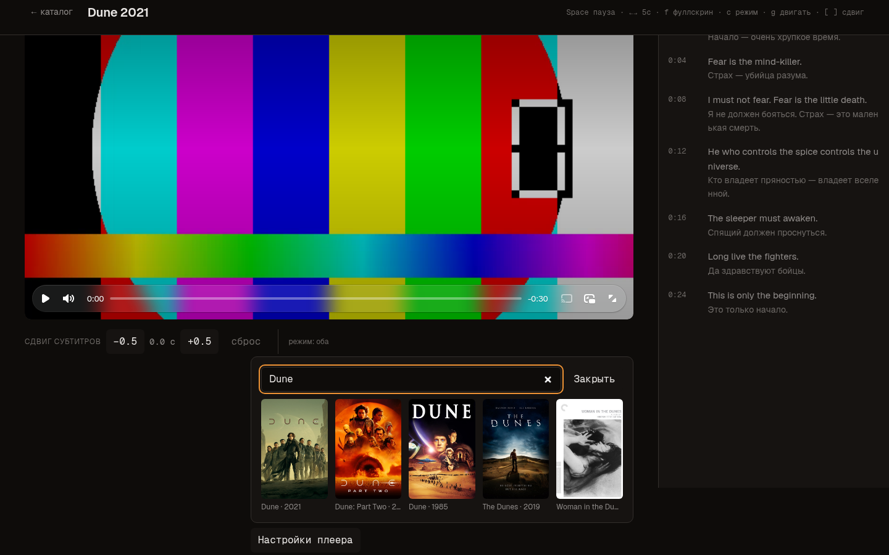

# subplayer

[Русский](README.ru.md) · **English**

[](LICENSE)
[](https://github.com/Liremant/subplayer/releases/latest)

A self-hosted video player for a personal media library, built around dual-language
subtitles. It serves local files over HTTP, renders both subtitle languages at once, and
provides the controls needed to align third-party subtitles with a specific release.

The application targets a single user on a local network. It has no accounts, no database,
and no external metadata catalogue; the library is the filesystem.

## Contents

- [Features](#features)
- [Screenshots](#screenshots)
- [Requirements](#requirements)
- [Installation](#installation)
- [Configuration](#configuration)
- [Library layout](#library-layout)
- [Subtitles](#subtitles)
- [Usage](#usage)
- [Keyboard shortcuts](#keyboard-shortcuts)
- [HTTP API](#http-api)
- [Development](#development)
- [Deployment](#deployment)
- [Project documentation](#project-documentation)
- [License](#license)

## Features

**Dual subtitles.** Both languages are rendered simultaneously from a single subtitle file.
Four display modes are available: both, original only, translation only, and off.

**Timing shift.** Subtitles can be shifted in 0.5 s steps while watching, which is the
primary means of aligning a subtitle track with a different release. The shift is stored per
video and applied to both the overlay and the cue list.

**Cue panel.** All cues are listed beside the video. Clicking a cue seeks to it; the active
cue is highlighted, kept in the vertical centre of the list, and the highlight persists
through gaps in dialogue until the next cue begins.

**Subtitle search.** Full-text search across both languages, with highlighting and direct
navigation to the matching cue.

**Free subtitle placement.** Font size and position are independent of any preset layout.
The block can be positioned anywhere in the frame as a percentage of its dimensions, either
with sliders or by dragging it with the pointer.

**Fullscreen with a dialogue column.** In fullscreen the video and a scrollable dialogue
column are displayed side by side, so the subtitles remain readable without covering the
picture.

**Catalogue.** Films and series are presented as a poster grid with playback progress,
search, and sorting. Episodes are grouped into their series automatically.

**Poster retrieval.** A poster may be supplied as a local file, or searched for by title and
downloaded from TVmaze (series) or the iTunes catalogue (films).

## Screenshots



| | |
|---|---|
|  |  |
| Player: both languages, cue panel, active cue highlighted | Fullscreen: dialogue column beside the video |
|  |  |
| Series page: resume control, episodes by season | Poster search and download |

## Requirements

| | Linux | macOS | Windows |
|---|---|---|---|
| Rust | [rustup](https://rustup.rs) | [rustup](https://rustup.rs) | [rustup](https://rustup.rs) with the MSVC toolchain |
| Node.js 20+ | distribution package or [nodejs.org](https://nodejs.org) | [nodejs.org](https://nodejs.org) or `brew install node` | [nodejs.org](https://nodejs.org) |
| pnpm | `corepack enable pnpm` | `corepack enable pnpm` | `corepack enable pnpm` |
| ffmpeg | `pacman -S ffmpeg` / `apt install ffmpeg` | `brew install ffmpeg` | `winget install Gyan.FFmpeg` |

ffmpeg is required only for media import (`scripts/import.sh`) and for generating the demo
library. It is not needed to play existing MP4 files.

## Installation

Prebuilt archives for Linux, macOS and Windows are attached to each
[release](https://github.com/Liremant/subplayer/releases). Extract the archive, place your
media in `media/`, run the `subplayer` binary, and open <http://127.0.0.1:3000>. The
frontend bundle is included; no build step is required.

### Building from source

The frontend must be built before the server, because the binary serves `web/dist` from disk
rather than embedding it.

#### Linux and macOS

```sh
git clone https://github.com/Liremant/subplayer.git
cd subplayer

cd web && pnpm install && pnpm build && cd ..
cargo build --release

./target/release/subplayer
```

On macOS, install the Xcode Command Line Tools if the linker is unavailable:

```sh
xcode-select --install
```

The correct target for the host architecture is selected automatically, including Apple
Silicon.

#### Windows

The MSVC toolchain is required. If Rust was installed without it:

```powershell
rustup default stable-msvc
```

Install "Build Tools for Visual Studio" with the "Desktop development with C++" workload if
the C++ build tools are missing, then:

```powershell
git clone https://github.com/Liremant/subplayer.git
cd subplayer

cd web; pnpm install; pnpm build; cd ..
cargo build --release

.\target\release\subplayer.exe
```

Windows PowerShell prior to version 7 does not accept `&&` as a command separator; use `;`
as shown, or run the Linux commands from Git Bash or WSL.

Paths are handled through `std::path::Path`, so `\` and `/` are interchangeable. To use a
library stored on another drive, set `SUBPLAYER_MEDIA` to an absolute path.

## Configuration

The server is configured through environment variables.

| Variable | Default | Description |
|---|---|---|
| `SUBPLAYER_MEDIA` | `media` | Root directory of the media library |
| `SUBPLAYER_DATA` | `data` | Playback progress, settings, downloaded posters |
| `SUBPLAYER_DIST` | `web/dist` | Built frontend bundle |
| `SUBPLAYER_PORT` | `3000` | Listening port |

The server binds to `127.0.0.1` only and is not reachable from other hosts by design. See
[Deployment](#deployment) for remote access.

## Library layout

```
media/
  Breaking Bad/S02/E05/
    video.mp4        # h264 + aac, moov atom at the start of the file
    subs.vtt         # both languages, original in <b>
    meta.json        # optional
  Dune.2021.1080p/
    video.mp4
    subs.vtt
    poster.jpg       # optional
```

The directory tree is scanned recursively: any directory containing a video file becomes a
library entry, and episodes are grouped into a series by name. Release-style names such as
`Dune.2021.1080p.BluRay.x264-GRP` are parsed automatically; the title, year and release tags
are separated without configuration.

A detailed guide to file naming, `meta.json`, posters and transcoding is available in
[docs/ADDING-MEDIA.md](docs/ADDING-MEDIA.md).

## Subtitles

Each video uses a single subtitle file in which every cue carries both languages, with the
original language marked up in `<b>`:

```
1
00:00:01.000 --> 00:00:03.000
<b>I am the one who knocks</b>
Я тот, кто стучится
```

A single file is used deliberately. The two languages are segmented into cues differently,
so combining two independent tracks by index or by timestamp fails on real data; one file
provides a single source of truth for segmentation.

Two SRT files can be merged into this format:

```sh
python3 scripts/merge-subs.py original.srt translation.srt -o subs.vtt
```

The script estimates the offset and scaling between releases automatically. Pass `--no-warp`
when the timings are already aligned.

## Usage

1. Place media in the directory configured by `SUBPLAYER_MEDIA`.
2. Open <http://127.0.0.1:3000>. The catalogue is rescanned on every request; no restart is
   required after adding files.
3. Select an entry to open the player. Films open the player directly; series open a page
   listing episodes by season.

Playback position is saved every five seconds while playing, on pause, and when the page is
closed. Reopening a video resumes from the saved position.

Subtitle alignment, display mode, size and position are adjusted from the player settings
panel, or with the keyboard shortcuts listed below. The timing shift is stored per video;
other subtitle settings are global defaults.

## Keyboard shortcuts

Shortcuts are matched by physical key position, so they work identically on any keyboard
layout, including Cyrillic.

| Key | Action |
|---|---|
| `Space`, `K` | Play / pause |
| `←` `→` | Seek −5 s / +5 s |
| `J` `L` | Seek −10 s / +10 s |
| `↑` `↓` | Volume |
| `0`–`9` | Seek to 10 %…90 % |
| `Home` `End` | Start / end |
| `M` | Mute |
| `F` | Fullscreen |
| `I` | Picture-in-picture |
| `C` | Cycle subtitle mode |
| `G` | Toggle subtitle dragging |
| `[` `]` | Shift subtitles −0.5 s / +0.5 s |
| `,` `.` | Playback rate |

## HTTP API

| Method | Path | Description |
|---|---|---|
| GET | `/api/library` | `{ movies, series }`, each episode carrying its saved progress |
| GET, PUT | `/api/settings` | Global settings |
| POST | `/api/progress` | `{ id, t, dur, shift }` |
| GET | `/api/posters/search?kind=&q=` | Poster candidates |
| POST | `/api/posters` | Download the selected poster into `data/posters/` |
| GET | `/media/<path>` | Media files, served with `Range` support |
| GET | `/posters/<file>` | Downloaded posters |

## Development

Run the backend and the Vite dev server concurrently. Vite serves the frontend with hot
module replacement and proxies `/api` and `/media` to the backend.

```sh
cargo run                          # terminal 1 — port 3000
cd web && pnpm dev                 # terminal 2 — port 5173
```

Open <http://localhost:5173>.

Before submitting a change:

```sh
cargo test
cargo fmt --check
cargo clippy --all-targets -- -D warnings
cd web && npx tsc --noEmit && pnpm build
```

The repository conventions are described in [AGENTS.md](AGENTS.md) (in Russian). Every
feature is developed on its own branch and merged into `main`.

## Deployment

### systemd (Linux)

```ini
# ~/.config/systemd/user/subplayer.service
[Unit]
Description=subplayer
After=network.target

[Service]
WorkingDirectory=%h/Projects/subplayer
ExecStart=%h/Projects/subplayer/target/release/subplayer
Restart=always
RestartSec=2

[Install]
WantedBy=default.target
```

```sh
systemctl --user daemon-reload
systemctl --user enable --now subplayer
journalctl --user -u subplayer -f
```

Restart the unit after rebuilding: `systemctl --user restart subplayer`. If `cargo run`
reports `AddrInUse`, the unit is already holding the port; restarting the unit is the correct
remedy, since it is configured to restart automatically.

macOS uses `launchd`; Windows uses Task Scheduler or a service wrapper such as NSSM. Unit
files for those platforms are not included.

### Remote access

The server binds to the loopback interface only. To access the library from other devices,
place a reverse proxy in front of it or use a mesh VPN. Authentication is not implemented and
is not planned: access control is delegated to the layer in front.

Container deployments require a bind address other than `127.0.0.1`, which is currently
hard-coded in `src/main.rs`; a `SUBPLAYER_HOST` variable would need to be added.

## Project documentation

| File | Contents | Language |
|---|---|---|
| [docs/ADDING-MEDIA.md](docs/ADDING-MEDIA.md) | Adding files, naming, posters, transcoding | English |
| [SPEC.md](SPEC.md) | Product requirements and non-goals | Russian |
| [AGENTS.md](AGENTS.md) | Repository conventions and constraints | Russian |

## License

Licensed under the [GNU Affero General Public License v3.0](LICENSE).

You may use, modify and redistribute this software. If you run a modified version as a
network service, you are required to make its source code available to its users. The code
cannot be incorporated into a closed-source product.
